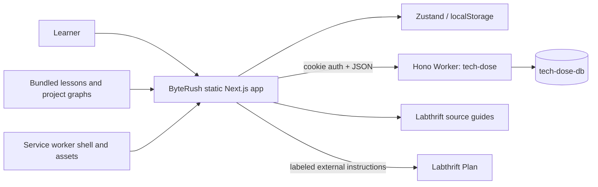

# ByteRush — High-Level Design

> Baseline: 2026-10-03. Product: ByteRush. Repository: `zemdregon/tech-dose`. Source-grounded design baseline; deployment and acceptance evidence is tracked separately in [release status](release-status.md).

## System context

The browser owns feed rendering, graph traversal and offline learning. The Worker owns passkey ceremonies, session authorization, payload validation, concurrent snapshot merges and D1 persistence. The existing D1 `progress` row is the learning source for account sync; quiz and inventory tables are structured mirrors.

## Boundaries
ByteRush’s database is independent of Plan’s `lab-plan` database and the main site’s metrics database. Matching parent-domain relying-party configuration does not share credential records or sessions. Runs contributes content and recommendation behavior only. Its former backend is not called by ByteRush.

## Deployment and trust
Next exports static pages to `out/`; Wrangler deploys those assets with a separate Hono Worker. `/api/*` goes to the Worker; app routes remain static. Production host is configured as `app.labthrift.com`. Passkey verification checks configured origin and RP ID; sessions store token hashes in ByteRush D1.

## Merge and retirement sequence
Copy and validate content → implement/test locally → commit replacement → deploy → verify live feed and authenticated sync → inventory remaining Runs resources → delete only Runs Worker/domain/DNS, exact D1, GitHub repository and checkout. Preserve Plan and the editorial site throughout. A failed release check stops the deletion sequence.

## Tradeoffs
A small fixed catalog is bundled for reliable offline reading. Snapshot sync is simpler than a new project service but requires explicit merge and reset rules. Future catalog growth may justify lazy loading; no such change is included here.
